# LEXGUARD

**Adversarial multi-agent contract analysis. Six AI agents argue over every clause before you sign.**


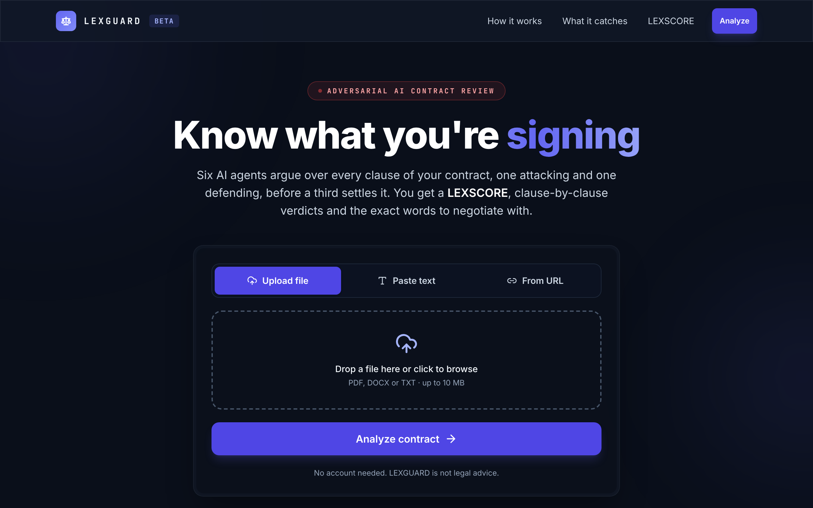

> **LEXGUARD is not legal advice.** It helps you understand a document; it does not replace a lawyer.

---

## Contents

- [Overview](#overview)
- [Screenshots](#screenshots)
- [Features](#features)
- [Tech stack](#tech-stack)
- [Architecture](#architecture)
- [Project structure](#project-structure)
- [Getting started](#getting-started)
- [Configuration](#configuration)
- [Running in development and production](#running-in-development-and-production)
- [Usage](#usage)
- [Scripts and commands](#scripts-and-commands)
- [API reference](#api-reference)
- [Security](#security)
- [Testing](#testing)
- [Linting and formatting](#linting-and-formatting)
- [Accessibility and UX](#accessibility-and-ux)
- [Deployment](#deployment)
- [Troubleshooting and FAQ](#troubleshooting-and-faq)
- [Known limitations](#known-limitations)
- [Roadmap ideas](#roadmap-ideas)
- [Contributing](#contributing)
- [License](#license)

---

## Overview

Most people sign offer letters, NDAs, freelance agreements, leases and terms of service without reading them closely, because legal language is slow to read and a lawyer is expensive. The clauses that hurt most (unilateral pay changes, broad IP grabs, one-sided indemnities, long non-competes) are easy to miss.

LEXGUARD takes a contract and runs it through a pipeline of Gemini-powered agents that **argue with each other** instead of producing a single summary:

1. one agent hunts for clauses that hurt the weaker party,
2. another argues the stronger party's case for each flagged clause,
3. a third settles the argument and scores the document.

You get a **0–100 LEXSCORE**, a RED / AMBER / GREEN verdict for every clause, plain-English explanations, worst-case scenarios, negotiation scripts, suggested redlines and a downloadable negotiation pack.

**Who it's for:** job seekers comparing offers, freelancers and contractors, tenants, and anyone about to accept a long agreement who wants to know what to push back on first.

It was built during the H2S *Build with AI* hackathon (Google for Developers).

---

## Screenshots

All screenshots were captured from the running app using the demo contract in [`samples/demo-employment.txt`](samples/demo-employment.txt). The backend was pointed at a local stand-in for the Gemini API that returns fixed demo output, so the text and scores below are example data, not a real model assessment.

| Analysis report (desktop) | Live agent progress |
| --- | --- |
| 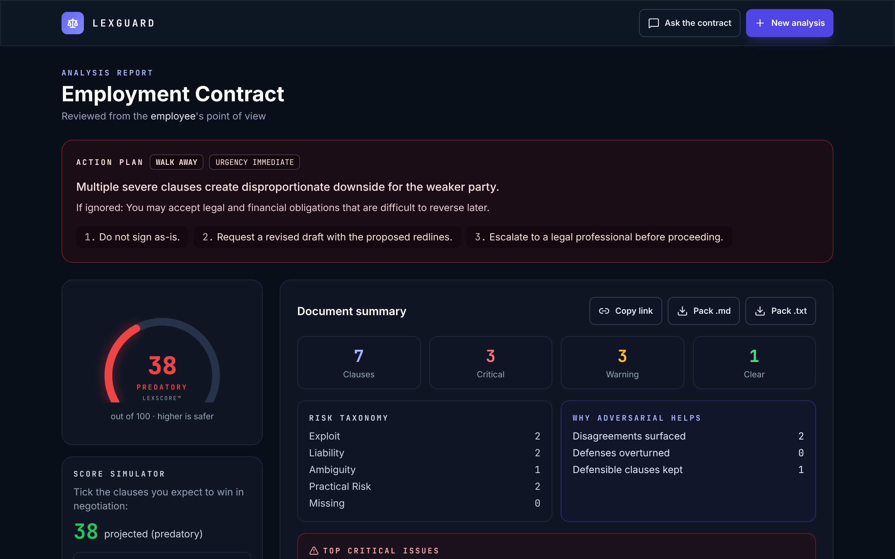 | 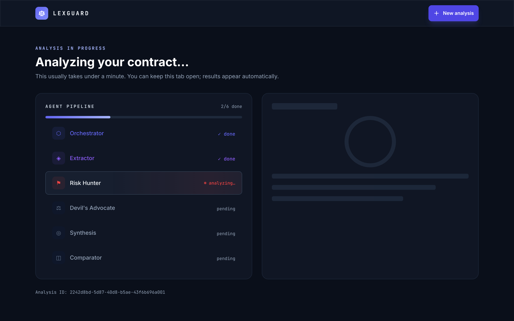 |

| Clause detail with adversarial trace | Contract chat |
| --- | --- |
| 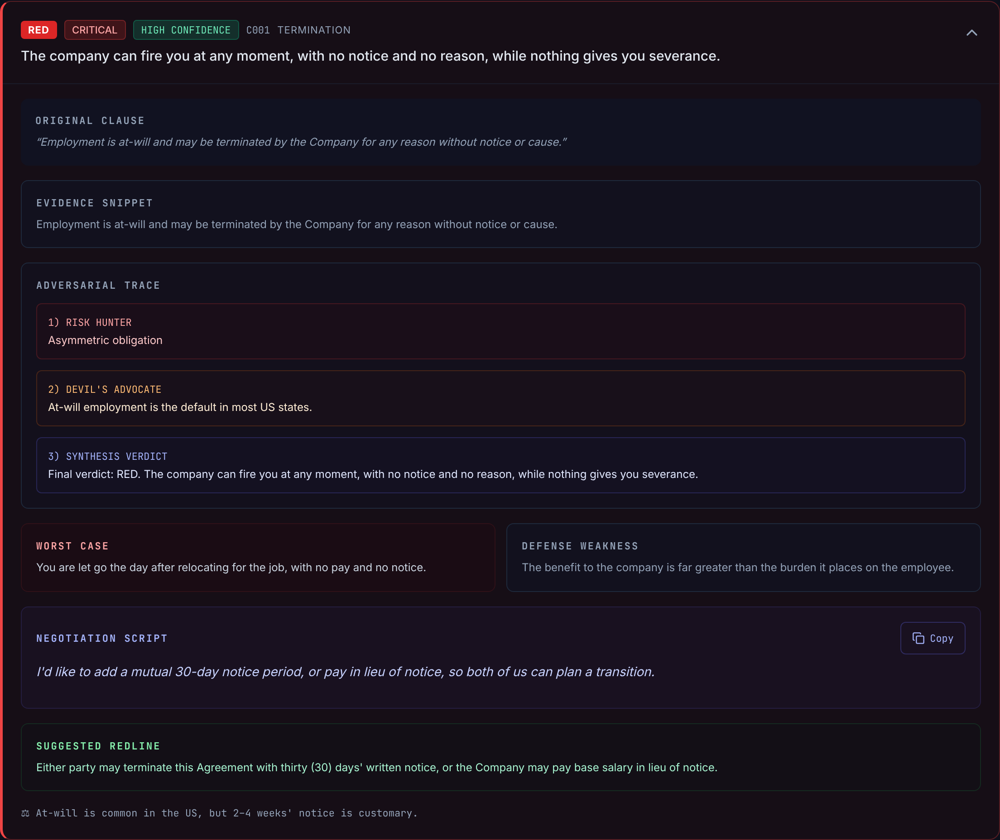 | 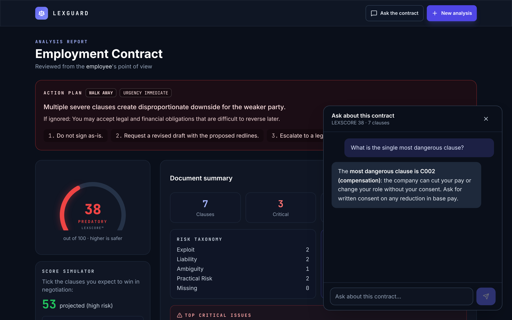 |

| Phone: landing page | Phone: report | Phone: chat |
| --- | --- | --- |
| 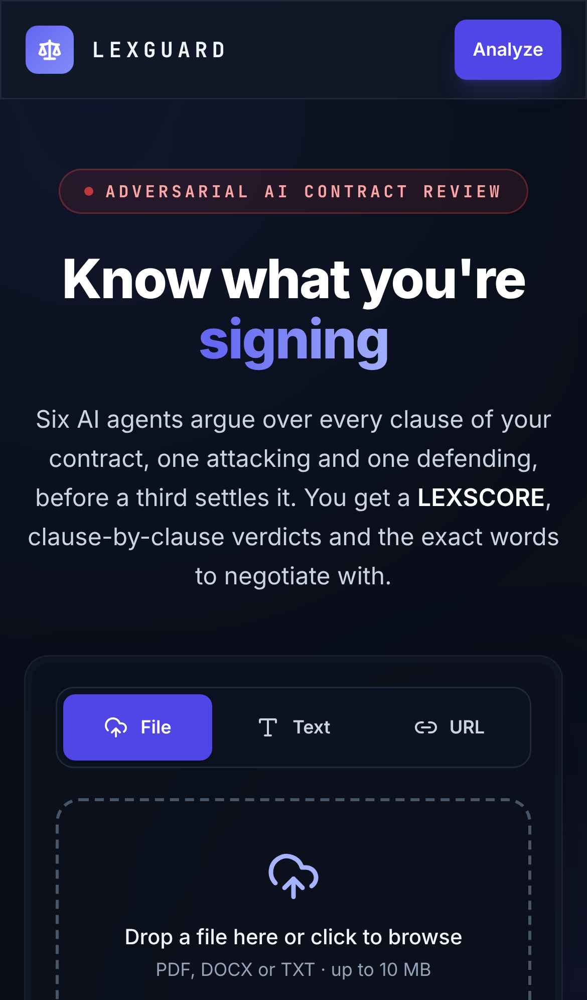 | 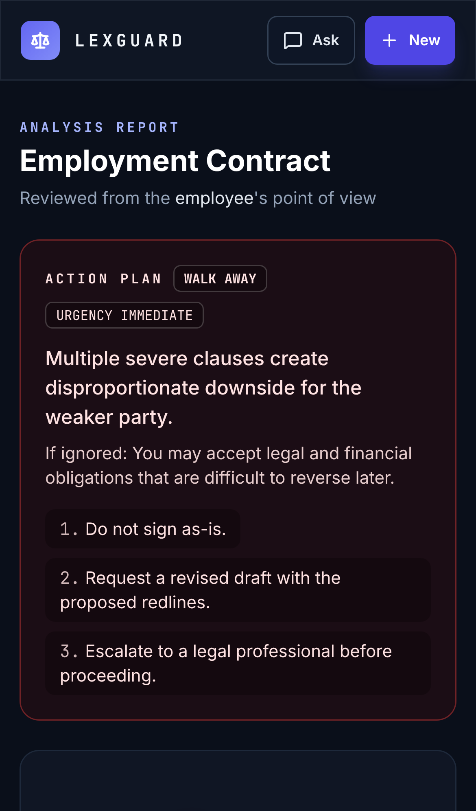 | 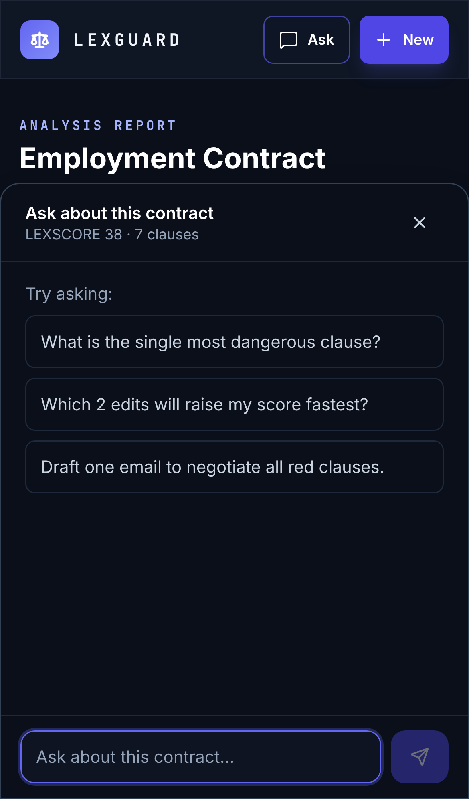 |

| Inline validation | Paste mode with sample | Expired / unknown analysis | 404 page |
| --- | --- | --- | --- |
| 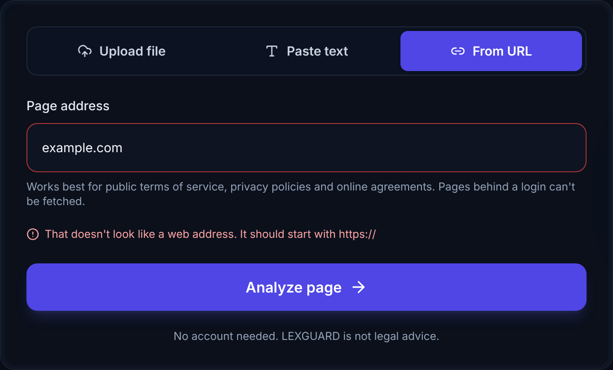 | 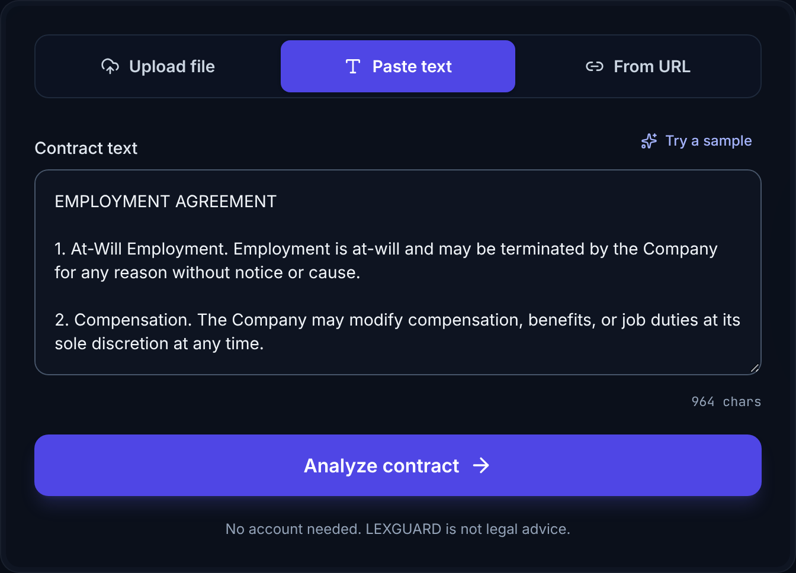 | 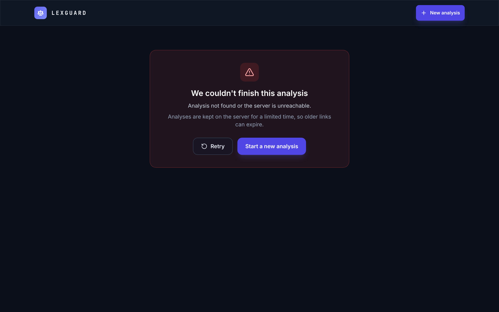 | 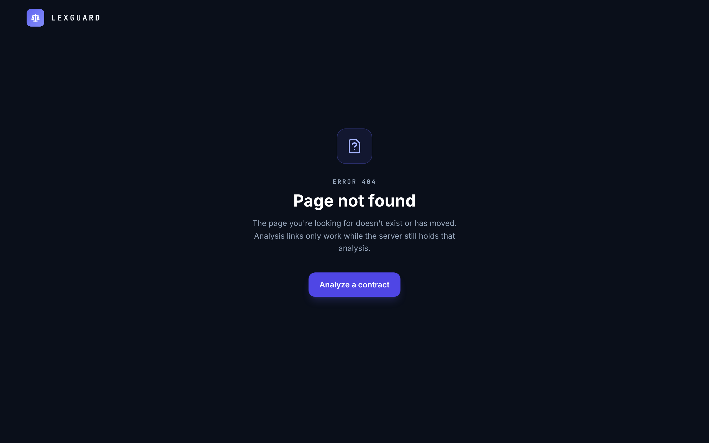 |

A full-length capture of the report page is in [`docs/screenshots/report-desktop-full.png`](docs/screenshots/report-desktop-full.png).

---

## Features

**Input**

- **Three ways to submit a document:** upload a PDF, DOCX or TXT file (up to 10 MB), paste text, or give a public URL.
- **Instant validation** for file type, file size, minimum text length (50 characters) and URL format, before anything is sent.
- **"Try a sample"** button that fills in a demo employment contract.

**Analysis**

- **Six-agent adversarial pipeline:** Orchestrator → Extractor → Risk Hunter → Devil's Advocate → Synthesis → Comparator.
- **Live progress:** agent status streams to the browser over Server-Sent Events, with a progress bar and screen-reader announcements. If the stream drops, the page falls back to polling.
- **Clause-level verdicts:** each clause gets a verdict, severity, risk type (exploit, liability, ambiguity, practical risk, missing protection), worst-case scenario, the opposing defense, a confidence level and an industry-norm comparison.
- **Action plan:** sign / negotiate first / walk away, with urgency, rationale and next steps.
- **Risk percentile** compared with similar documents, plus jurisdiction hints.

**Acting on the result**

- **Score simulator:** tick the clauses you expect to win in negotiation and see the projected score.
- **Negotiation scripts and redlines** for each risky clause, with one-click copy.
- **Negotiation pack:** a Markdown or TXT download with the riskiest clauses, a ready-to-send email and clause-by-clause redlines.
- **Contract chat:** ask follow-up questions about the analyzed document.
- **Offer comparison (beta):** analyze two offers in parallel and see which scores better.
- **Shareable report link** while the server keeps the analysis.

**Optional integrations**

- **Voice (ElevenLabs):** audio briefing, a two-voice clause debate and a negotiation coach. The buttons only appear when the backend has an ElevenLabs key.
- **Voice agent (ElevenLabs Conversational AI):** a widget on the report page backed by the `/v1/chat/completions` endpoint.
- **Phone briefings (Twilio):** an operator can call a number and have the analysis summary read out.

---

## Tech stack

| Layer | Technology |
| --- | --- |
| Frontend | Next.js 16 (App Router), React 19, TypeScript 5, Tailwind CSS 3, lucide-react icons, `next/font` (Inter, JetBrains Mono) |
| Backend | Python 3.11+, FastAPI 0.163, Pydantic v2, httpx, Uvicorn |
| AI | Google Gemini (`gemini-2.5-flash` by default) through the REST `generateContent` API |
| Document parsing | PyMuPDF (PDF), python-docx (DOCX), built-in HTML-to-text for URLs |
| Persistence | In-memory store (development) or Google Cloud Firestore (production) |
| Voice / phone | ElevenLabs, Twilio (both optional) |
| Testing | pytest (backend), Vitest + jsdom (frontend) |
| Code quality | Ruff (lint + format), ESLint 9 flat config, Prettier, `tsc --noEmit` |
| CI | GitHub Actions (`.github/workflows/ci.yml`) |
| Deployment | Docker, Google Cloud Run |

---

## Architecture

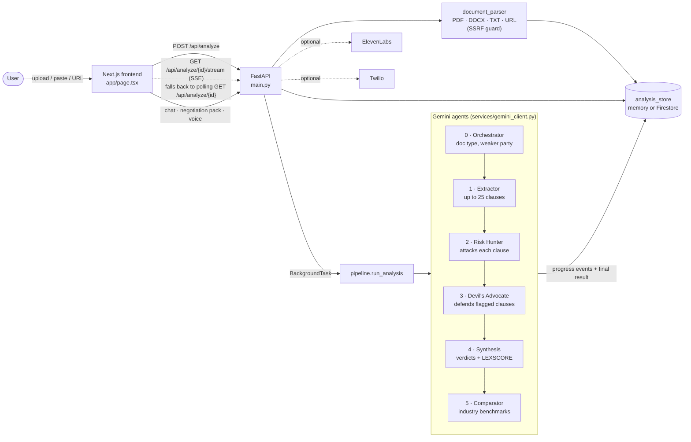

**Request lifecycle**

1. The frontend posts the document as `multipart/form-data`. The backend extracts the text, creates an analysis record and returns its `analysis_id` immediately.
2. The six agents run as a FastAPI background task. Each step appends a progress event to the record.
3. The frontend opens `/api/analyze/{id}/stream`. The stream relays progress events, then sends the final result. If the connection drops, the frontend polls `GET /api/analyze/{id}` every 2.5 s instead.
4. `services/pipeline.py` merges the agent outputs into a typed `LexGuardAnalysis`: verdict counts, risk taxonomy, confidence, action plan and adversarial metrics.

**Scoring.** The Synthesis agent starts at 100 and subtracts 15 per CRITICAL clause, 8 per HIGH, 4 per MEDIUM, 1 per LOW and 5 per missing protection, with an extra −3 for each indefensible clause and +2 for each strongly defended one (floor 0). Labels: 0–19 HOSTILE, 20–39 PREDATORY, 40–59 HIGH RISK, 60–79 MODERATE, 80–89 GOOD, 90–100 EXCELLENT.

**Action plan.** Derived in code, not by the model: *walk away* if the score is under 40 or there are 3+ RED clauses; *negotiate first* if the score is under 80, any clause is RED or 2+ are AMBER; otherwise *sign*.

**Persistence.** With `ENVIRONMENT=production` or `GCP_PROJECT_ID` set, analyses are stored in Firestore, so multiple Cloud Run instances or workers share state. Otherwise an in-memory store is used. It holds up to 500 analyses per process, so run a single worker (`WEB_CONCURRENCY=1`, the Docker default) in that mode.

---

## Project structure

```
.
├── backend/                     FastAPI service
│   ├── main.py                  App, CORS, every HTTP route, SSE stream
│   ├── config.py                Environment configuration and limits
│   ├── security.py              Bearer-token guards, HMAC signing for TTS URLs
│   ├── agents/                  One module per Gemini agent
│   │   ├── orchestrator.py      Document type, weaker party, jurisdiction
│   │   ├── extractor.py         Clause extraction (max 25)
│   │   ├── risk_hunter.py       Attacks clauses on behalf of the weaker party
│   │   ├── devils_advocate.py   Defends flagged clauses
│   │   ├── synthesis.py         Final verdicts and LEXSCORE
│   │   ├── comparator.py        Industry benchmarks
│   │   └── chat.py              Follow-up Q&A over a finished analysis
│   ├── models/schemas.py        Pydantic response models
│   ├── services/
│   │   ├── pipeline.py          Agent orchestration and result merging
│   │   ├── analysis_store.py    Firestore / bounded in-memory persistence
│   │   ├── document_parser.py   PDF/DOCX/TXT/URL extraction with SSRF guard
│   │   ├── gemini_client.py     Gemini REST client (key sent as a header)
│   │   ├── negotiation_pack.py  Markdown/TXT pack and briefing script
│   │   ├── elevenlabs_client.py Optional text-to-speech
│   │   └── twilio_client.py     Optional outbound calls
│   ├── tests/                   pytest suite (Gemini fully stubbed)
│   ├── Dockerfile               Production image, honours $PORT
│   ├── pyproject.toml           Ruff and pytest configuration
│   ├── requirements.txt         Runtime dependencies (pinned)
│   └── requirements-dev.txt     + pytest, ruff, pip-audit
├── frontend/                    Next.js app
│   ├── app/
│   │   ├── page.tsx             Landing page, upload form, offer comparison
│   │   ├── analyze/[id]/        Live progress and analysis report
│   │   ├── layout.tsx           Fonts, metadata, skip link
│   │   ├── globals.css          Design tokens in use, component primitives
│   │   ├── icon.svg             Favicon
│   │   ├── opengraph-image.tsx  Generated social preview image
│   │   ├── error.tsx            Error boundary
│   │   └── not-found.tsx        404 page
│   ├── components/              ClauseCard, LexScore gauge, AgentThinking,
│   │                            AudioPlayer, VoiceWidget, Logo, …
│   ├── lib/
│   │   ├── api.ts               Backend client (fetch + EventSource)
│   │   ├── scoring.ts           Filtering, sorting, score projection
│   │   ├── validation.ts        Client-side input checks
│   │   ├── samples.ts           Demo contract for "Try a sample"
│   │   └── types.ts             Shared response types
│   ├── __tests__/               Vitest suite
│   ├── tailwind.config.ts       Colour, type and layout tokens
│   └── Dockerfile               Standalone production image
├── samples/                     Demo contracts (employment, freelance, SaaS ToS)
├── scripts/
│   ├── gcp-setup.sh             Backend-only GCP setup (APIs, Firestore, Secret Manager, Cloud Run)
│   ├── gcp-deploy.sh            Deploy both services to Cloud Run
│   └── test-gemini.sh           Smoke-test a Gemini API key
├── docs/
│   ├── gcp.md                   Google Cloud guide
│   ├── design-notes.md          Original hackathon design notes
│   └── screenshots/             Images used in this README
└── .github/workflows/ci.yml     Lint, test, audit and build on push / PR
```

---

## Getting started

### Prerequisites

| Tool | Version | Notes |
| --- | --- | --- |
| Python | 3.11 or newer | CI tests 3.11 and 3.12 |
| Node.js | 20.9 or newer | 22 recommended (used by CI and the Dockerfile) |
| npm | bundled with Node | `package-lock.json` is committed |
| Gemini API key | — | Free from [Google AI Studio](https://aistudio.google.com/apikey) |
| Docker | optional | Only for container builds |
| Google Cloud SDK | optional | Only for Cloud Run deployment |

### 1. Clone

```bash
git clone https://github.com/jeevithg090/Scaler-Hack.git
cd Scaler-Hack
```

### 2. Backend

```bash
cd backend
python3 -m venv .venv
source .venv/bin/activate            # Windows: .venv\Scripts\activate
pip install -r requirements-dev.txt
cp .env.example .env                 # then set GEMINI_API_KEY in .env
set -a; source .env; set +a          # the app reads plain environment variables
uvicorn main:app --reload --port 8000
```

Check it's up:

```bash
curl http://localhost:8000/api/health
```

Interactive OpenAPI docs are at <http://localhost:8000/docs>.

### 3. Frontend

In a second terminal:

```bash
cd frontend
npm install
cp .env.local.example .env.local     # NEXT_PUBLIC_API_URL defaults to http://localhost:8000
npm run dev
```

Open <http://localhost:3000>, choose **Paste text**, click **Try a sample** and then **Analyze contract**.

---

## Configuration

The backend reads plain environment variables (see [`backend/.env.example`](backend/.env.example)); it does not load `.env` by itself, so export them in your shell, Docker or Cloud Run.

### Backend

| Variable | Required | Default | Description |
| --- | --- | --- | --- |
| `GEMINI_API_KEY` | **yes** | — | Gemini API key. Analyses fail without it. |
| `GEMINI_MODEL` | no | `gemini-2.5-flash` | Gemini model name. |
| `GEMINI_BASE` | no | `https://generativelanguage.googleapis.com/v1beta` | Gemini REST base URL. Point it at a mock server for offline testing. |
| `GEMINI_TIMEOUT_SECONDS` | no | `120` | Timeout for each Gemini request. |
| `ENVIRONMENT` | no | `development` | `production` switches persistence to Firestore. |
| `CORS_ORIGINS` | no | `http://localhost:3000,http://127.0.0.1:3000` | Comma-separated browser origins allowed to call the API. |
| `ELEVENLABS_API_KEY` | no | — | Enables the voice endpoints and the voice buttons in the UI. |
| `ELEVENLABS_MODEL_ID` | no | `eleven_multilingual_v2` | ElevenLabs TTS model. |
| `ELEVENLABS_NARRATOR_VOICE_ID` | no | built-in voice id | Voice for briefings. |
| `ELEVENLABS_RISK_HUNTER_VOICE_ID` | no | built-in voice id | Attacker voice in the clause debate. |
| `ELEVENLABS_DEFENDER_VOICE_ID` | no | built-in voice id | Defender voice in the clause debate. |
| `CUSTOM_LLM_API_KEY` | no | — | Bearer token for `/v1/chat/completions`. The endpoint is disabled when unset. |
| `TWILIO_ACCOUNT_SID` | no | — | Twilio account SID for phone briefings. |
| `TWILIO_AUTH_TOKEN` | no | — | Twilio auth token. |
| `TWILIO_FROM_NUMBER` | no | — | Twilio caller number (E.164). |
| `PUBLIC_BASE_URL` | no | — | Public HTTPS URL of the backend that Twilio can reach. |
| `ADMIN_API_TOKEN` | no | — | Bearer token for `POST /api/twilio/call`. Calling is disabled when unset. |
| `TTS_SIGNING_SECRET` | no | `TWILIO_AUTH_TOKEN` | HMAC secret for signed TTS URLs. |
| `GCP_PROJECT_ID` | no | — | Setting it enables Firestore persistence. |
| `FIRESTORE_COLLECTION` | no | `analyses` | Firestore collection name. |
| `GCS_BUCKET_NAME` | no | — | Only reported by the health check; not used by the code yet. |
| `WEB_CONCURRENCY` | no | `1` (Docker) | Uvicorn worker count in the Docker image. Keep `1` without Firestore. |
| `PORT` | no | `8080` (Docker) | Port the Docker image listens on (Cloud Run sets it). |

Built-in limits (in `backend/config.py`): uploads up to 10 MB, documents up to 200,000 characters, URL fetches up to 5 MB, chat messages up to 2,000 characters, and a minimum of 50 characters of document text.

### Frontend

`NEXT_PUBLIC_*` values are inlined into the JavaScript bundle at **build** time, so rebuild after changing them.

| Variable | Required | Default | Description |
| --- | --- | --- | --- |
| `NEXT_PUBLIC_API_URL` | no | `http://localhost:8000` | Backend base URL. |
| `NEXT_PUBLIC_ELEVENLABS_AGENT_ID` | no | — | ElevenLabs Conversational AI agent id. When set, a voice widget appears on the report page. |
| `NEXT_PUBLIC_SITE_URL` | no | `http://localhost:3000` | Public URL of the frontend, used for absolute Open Graph image links. |

---

## Running in development and production

| | Backend | Frontend |
| --- | --- | --- |
| Development (hot reload) | `uvicorn main:app --reload --port 8000` | `npm run dev` |
| Production (local) | `uvicorn main:app --host 0.0.0.0 --port 8000 --workers 1` | `npm run build && npm start` |
| Production (Docker) | `docker run -p 8080:8080 -e GEMINI_API_KEY=… lexguard-backend` | `docker run -p 3000:3000 lexguard-frontend` |

The frontend build uses Next.js `output: "standalone"`. `npm start` works for local checks; the Docker image runs the standalone `server.js` instead.

---

## Usage

### In the browser

1. **Choose an input mode** on the landing page: *Upload file*, *Paste text* or *From URL*. Invalid input (wrong file type, over 10 MB, under 50 characters, not an `http(s)` URL) is explained under the field.
2. **Click "Analyze contract".** You're taken to `/analyze/{id}`, where a progress bar and agent list update as each agent finishes. Results usually arrive in under a minute, depending on Gemini latency and document length.
3. **Read the report** from top to bottom:
   - **Action plan:** the recommendation, urgency and next steps.
   - **LEXSCORE gauge** and **score simulator**: tick clauses to see the projected score if you win them.
   - **Document summary:** clause counts, risk taxonomy, adversarial metrics and top critical issues.
   - **Risk percentile**, jurisdiction hints and a **before-you-sign checklist**.
   - **Missing protections.**
   - **Clause breakdown:** filter by RED / AMBER / GREEN; expand a clause for the original text, the attack-defense-verdict trace, worst case, negotiation script (with copy button) and suggested redline.
4. **Take it further:** *Copy link* to share the report, *Pack .md* / *Pack .txt* to download the negotiation pack, or *Ask the contract* to open the chat. Press <kbd>Esc</kbd> to close the chat.
5. **Compare offers:** on the landing page, paste two offers into *Compare two offers* and the report shows both scores and which is safer.

### With the API (curl)

Start an analysis from text:

```bash
curl -s -X POST http://localhost:8000/api/analyze \
  -F "text=$(cat samples/demo-employment.txt)"
```

```json
{ "analysis_id": "4bad28f0-24dc-46fa-b024-94e21969a9ba" }
```

Upload a file, or analyze a public URL, instead:

```bash
curl -s -X POST http://localhost:8000/api/analyze -F "file=@contract.pdf"
curl -s -X POST http://localhost:8000/api/analyze -F "url=https://example.com/terms"
```

Follow progress as Server-Sent Events:

```bash
curl -N http://localhost:8000/api/analyze/<id>/stream
```

```text
data: {"agent": "orchestrator", "status": "running"}

data: {"agent": "orchestrator", "status": "complete", "result": {"doc_type": "employment_contract", "weaker_party": "employee", ...}}

data: {"agent": "extractor", "status": "running"}
...
data: {"type": "complete", "data": { ...full analysis... }}
```

Fetch the result (one clause shown; trimmed):

```bash
curl -s http://localhost:8000/api/analyze/<id>
```

```json
{
  "analysis_id": "4bad28f0-24dc-46fa-b024-94e21969a9ba",
  "status": "complete",
  "doc_type": "employment_contract",
  "weaker_party": "employee",
  "lexscore": 38,
  "lexscore_label": "PREDATORY",
  "summary": {
    "total_clauses": 7, "red_clauses": 3, "amber_clauses": 3, "green_clauses": 1,
    "critical_issues": ["You can be fired instantly with no notice or severance.", "..."]
  },
  "clauses": [
    {
      "clause_id": "C001",
      "clause_type": "termination",
      "verdict": "RED",
      "severity": "CRITICAL",
      "risk_type": "EXPLOIT",
      "plain_english": "The company can fire you at any moment, with no notice and no reason...",
      "defense_argument": "At-will employment is the default in most US states.",
      "defense_strength": "WEAK",
      "negotiation_script": "I'd like to add a mutual 30-day notice period...",
      "suggested_redline": "Either party may terminate this Agreement with thirty (30) days' written notice...",
      "confidence": "HIGH"
    }
  ],
  "missing_protections": ["No severance or notice pay", "..."],
  "action_plan": { "recommendation": "WALK_AWAY", "urgency": "IMMEDIATE", "next_steps": ["Do not sign as-is.", "..."] },
  "document_benchmark": { "percentile": 84, "industry_comparison": "..." }
}
```

Ask a follow-up question:

```bash
curl -s -X POST http://localhost:8000/api/analyze/<id>/chat \
  -H "Content-Type: application/json" \
  -d '{"message": "What is the single most dangerous clause?"}'
```

```json
{ "reply": "The **most dangerous clause is C002 (compensation)**: ..." }
```

Download the negotiation pack:

```bash
curl -s -OJ "http://localhost:8000/api/analyze/<id>/negotiation-pack?format=md"
```

```markdown
# LEXGUARD Negotiation Pack

- Analysis ID: 4bad28f0-24dc-46fa-b024-94e21969a9ba
- LEXSCORE: 38 (PREDATORY)
- Document Type: employment contract
- Weaker Party: employee

## Top Risky Clauses

### 1. C001 — termination
- Verdict: RED | Severity: CRITICAL
...
```

Errors are JSON with a `detail` field, for example:

```json
{ "detail": "Document too short — paste at least ~50 characters" }
```

---

## Scripts and commands

### Frontend (`frontend/package.json`)

| Command | What it does |
| --- | --- |
| `npm run dev` | Start the Next.js dev server on port 3000 |
| `npm run build` | Production build (standalone output); fails on type or lint errors |
| `npm start` | Serve the production build |
| `npm run lint` | ESLint (Next.js core-web-vitals + TypeScript rules) |
| `npm run typecheck` | `tsc --noEmit` |
| `npm run format` | Format with Prettier |
| `npm run format:check` | Check formatting without writing |
| `npm test` | Run the Vitest suite once |

### Backend (run inside `backend/` with the virtualenv active)

| Command | What it does |
| --- | --- |
| `uvicorn main:app --reload --port 8000` | Dev server with hot reload |
| `pytest` | Run the test suite |
| `ruff check .` | Lint |
| `ruff format .` / `ruff format --check .` | Format / check formatting |
| `pip-audit -r requirements.txt` | Scan runtime dependencies for known vulnerabilities |

### Repository scripts (`scripts/`)

| Script | What it does |
| --- | --- |
| `GEMINI_API_KEY=… ./scripts/test-gemini.sh` | Smoke-test a Gemini key and model with a few requests |
| `PROJECT_ID=… ./scripts/gcp-setup.sh` | Backend-only setup: optional billing link, APIs, Firestore, bucket, Gemini key in Secret Manager, Cloud Run deploy and an uptime check |
| `./scripts/gcp-deploy.sh` | Build and deploy both services to Cloud Run, then wire CORS and the public URL |

---

## API reference

Base URL: `http://localhost:8000` in development. Full schemas: <http://localhost:8000/docs>.

| Method | Path | Auth | Description |
| --- | --- | --- | --- |
| `GET` | `/api/health` | none | Status, model, uptime, queue depth and which optional integrations are configured |
| `POST` | `/api/analyze` | none | Start an analysis. `multipart/form-data` with one of `file` (PDF/DOCX/TXT ≤ 10 MB), `text`, or `url`. Returns `{analysis_id}` |
| `GET` | `/api/analyze/{id}` | none | Current state or final result (document text and internal events are stripped) |
| `GET` | `/api/analyze/{id}/stream` | none | Server-Sent Events: agent progress, then `{"type":"complete","data":…}` or `{"type":"error"}`. Times out after 10 minutes |
| `POST` | `/api/analyze/{id}/chat` | none | JSON `{"message": "…"}` (1–2000 chars). Returns `{"reply": "…"}`. Needs a completed analysis |
| `GET` | `/api/analyze/{id}/negotiation-pack?format=md\|txt` | none | Download the negotiation pack |
| `POST` | `/api/analyze/{id}/voice/briefing` | none | MP3 audio briefing (needs `ELEVENLABS_API_KEY`, else 503) |
| `POST` | `/api/analyze/{id}/voice/debate/{clause_id}` | none | MP3 two-voice debate for one clause (ElevenLabs) |
| `POST` | `/api/analyze/{id}/voice/negotiate/{clause_id}` | none | MP3 negotiation coaching for one clause (ElevenLabs) |
| `POST` | `/api/twilio/call` | `Bearer ADMIN_API_TOKEN` | Place an outbound call. JSON `{"to_number": "+1…", "analysis_id"?: "…", "message"?: "…"}` |
| `GET`, `POST` | `/api/twilio/voice` | Twilio webhook | TwiML for the call |
| `GET` | `/api/twilio/tts.mp3?text=…&sig=…` | HMAC signature | Signed TTS audio for Twilio; unsigned requests get 403 |
| `POST` | `/api/twilio/status` | Twilio webhook | Call status callback (logged) |
| `POST` | `/v1/chat/completions` | `Bearer CUSTOM_LLM_API_KEY` | OpenAI-compatible streaming endpoint for the ElevenLabs agent |

Common status codes: `400` invalid or too-short input, unsupported file, or a non-public URL; `404` unknown analysis id; `409` chat, pack or voice requested before the analysis is complete; `413` upload over 10 MB; `502` Gemini unavailable; `503` an optional integration isn't configured.

---

## Security

- CORS only allows origins listed in `CORS_ORIGINS`.
- URL fetching resolves the host and refuses loopback, private and link-local addresses on every redirect hop (SSRF protection). Responses are capped at 5 MB.
- `POST /api/twilio/call` places real phone calls, so it requires `Authorization: Bearer $ADMIN_API_TOKEN` and is disabled when no token is set.
- `/v1/chat/completions` requires `Authorization: Bearer $CUSTOM_LLM_API_KEY` and is disabled when no key is set.
- TTS URLs handed to Twilio are HMAC-signed, so `/api/twilio/tts.mp3` is not an open text-to-speech proxy.
- The Gemini key is sent in a request header, never in a URL. Upstream error bodies are not passed on to clients.
- `GET /api/analyze/{id}` never returns the original document text or the internal event log.
- Secrets live only in environment variables. Never commit `backend/.env`.

---

## Testing

```bash
# backend (85 tests)
cd backend && pytest -q

# frontend (24 tests)
cd frontend && npm test
```

**Backend.** Every Gemini call is stubbed, so the suite needs no API key or network. It covers result merging and verdict thresholds in the pipeline, PDF/DOCX/HTML parsing, the SSRF guards, the Gemini client (headers, JSON parsing, errors), the memory store, bearer-token and HMAC auth, the negotiation pack, and every HTTP endpoint.

**Frontend.** Vitest with jsdom covers the scoring helpers (filtering, sorting, score projection, labels), the API client (form submission, chat replies and error messages) and the input validation rules.

**Manual end-to-end check without a Gemini key.** Point `GEMINI_BASE` at any HTTP server that answers `POST /models/<model>:generateContent` with a Gemini-shaped response (`{"candidates":[{"content":{"parts":[{"text":"<json>"}]}}]}`), set `GEMINI_API_KEY` to any non-empty value, and run both apps as usual. This is how the screenshots in this README were produced.

---

## Linting and formatting

| Area | Tool | Config |
| --- | --- | --- |
| Python lint + format | Ruff | `backend/pyproject.toml` |
| TypeScript / React lint | ESLint 9 (`eslint-config-next`) | `frontend/eslint.config.mjs` |
| Formatting (frontend) | Prettier, 100-column lines | `frontend/.prettierrc.json` |
| Types | TypeScript strict mode | `frontend/tsconfig.json` |

CI runs all of these, plus `pip-audit` and `npm audit --omit=dev`, on every push to `main` or `polish/**` and on pull requests.

---

## Accessibility and UX

The UI is dark-first and was checked with [axe-core](https://github.com/dequelabs/axe-core) (WCAG 2 A/AA and best-practice rules) on the landing page, the report (with a clause expanded and chat open), the error state and the 404 page, at 375 px and 1280 px, with no violations. It was also exercised with Playwright at 375 px, 768 px and 1280 px wide with no horizontal scrolling.

- Colour tokens are chosen for at least 4.5:1 text contrast on the dark background; the smallest text size is 11 px.
- Visible focus rings on every interactive element, a "Skip to content" link, and semantic landmarks and headings.
- Labelled form fields with error messages linked via `aria-describedby` and announced through live regions.
- Toggle buttons expose `aria-pressed`, clause cards expose `aria-expanded`, the progress bar uses `role="progressbar"`, and the chat panel is a labelled dialog that takes focus and closes on <kbd>Esc</kbd>.
- Touch targets are at least 40–44 px tall.
- Animations are disabled when the operating system requests reduced motion.
- Loading, empty, error and success states exist for every fetch or submit: progress and skeletons while agents run, a retryable error page, a toast for failed downloads, and an empty state for clause filters.

---

## Deployment

### Docker

Both services ship production Dockerfiles. The backend runs as a non-root user, honours `$PORT` and has a health check. The frontend is a multi-stage build using Next.js standalone output.

```bash
docker build -t lexguard-backend backend
docker run -p 8080:8080 \
  -e GEMINI_API_KEY=your-key \
  -e CORS_ORIGINS=http://localhost:3000 \
  lexguard-backend

docker build -t lexguard-frontend \
  --build-arg NEXT_PUBLIC_API_URL=http://localhost:8080 \
  frontend
docker run -p 3000:3000 lexguard-frontend
```

### Google Cloud Run

[`scripts/gcp-deploy.sh`](scripts/gcp-deploy.sh) does the full setup from Cloud Shell or any machine with `gcloud`:

1. Enables the required APIs, creates a Cloud Storage bucket with a lifecycle rule and creates the Firestore database.
2. Deploys the backend from source with secrets read from `backend/.env`, `ENVIRONMENT=production` and 2 workers (safe because Firestore is shared).
3. Deploys the frontend with `NEXT_PUBLIC_API_URL` set to the backend URL.
4. Updates the backend's `CORS_ORIGINS` and `PUBLIC_BASE_URL` to the deployed URLs.

```bash
PROJECT_ID=your-project REGION=us-central1 ./scripts/gcp-deploy.sh
```

For production, move secrets from `--set-env-vars` to Secret Manager (`--set-secrets`). See [`docs/gcp.md`](docs/gcp.md) for details.

### ElevenLabs voice agent

Create an ElevenLabs Conversational AI agent that uses a **custom LLM** pointed at `https://<backend>/v1/chat/completions`, set its API key to `CUSTOM_LLM_API_KEY`, then build the frontend with `NEXT_PUBLIC_ELEVENLABS_AGENT_ID`. The widget passes the analysis id as the `UUID` dynamic variable.

### Twilio phone briefings

Set the Twilio variables, `PUBLIC_BASE_URL` and `ADMIN_API_TOKEN` (for local development, expose the backend with `ngrok http 8000`). Then:

```bash
curl -X POST http://localhost:8000/api/twilio/call \
  -H "Authorization: Bearer $ADMIN_API_TOKEN" \
  -H "Content-Type: application/json" \
  -d '{"to_number": "+1XXXXXXXXXX", "analysis_id": "<analysis id>"}'
```

With ElevenLabs configured the call plays ElevenLabs audio; otherwise Twilio's built-in voice reads the briefing.

---

## Troubleshooting and FAQ

**"We couldn't reach the LEXGUARD server" when I click Analyze.**
The browser can't reach `NEXT_PUBLIC_API_URL`. Check the backend is running (`curl http://localhost:8000/api/health`), that the URL in `frontend/.env.local` is right, and rebuild the frontend if you changed it (the value is baked in at build time).

**The browser console shows a CORS error.**
Add the frontend's exact origin (scheme, host and port) to `CORS_ORIGINS` on the backend and restart it.

**The analysis fails straight away, or the health check shows `"gemini_api_key": false`.**
`GEMINI_API_KEY` isn't set in the backend's environment. Remember the backend doesn't read `.env` itself: run `set -a; source .env; set +a` first. Use `scripts/test-gemini.sh` to confirm the key works.

**The progress page never finishes.**
If you run more than one Uvicorn worker without Firestore, the analysis and the stream may land in different processes. Use one worker (`WEB_CONCURRENCY=1`) or enable Firestore. The stream gives up after 10 minutes.

**An old report link shows "We couldn't finish this analysis".**
The in-memory store keeps the 500 most recent analyses and is cleared when the backend restarts. Use Firestore for durable links.

**"URL must point to a public internet host".**
The SSRF guard blocks localhost, private and link-local addresses. Paste the text instead, or host the page publicly.

**"Document too short".**
At least 50 characters of text are needed. Scanned PDFs without a text layer extract as empty; run OCR first or paste the text.

**I don't see the audio buttons.**
They only appear when the backend has `ELEVENLABS_API_KEY` set (the frontend reads this from `/api/health`).

**Is my document stored?**
The document text is kept in the analysis record (memory or Firestore) so chat can work, but it is never returned by the API. There is no automatic deletion; clear the Firestore collection or restart the in-memory backend to remove data.

---

## Known limitations

- **AI output can be wrong.** Verdicts, scores, percentiles and "industry norms" are model-generated and not verified against a legal database.
- **English-language, US-leaning prompts.** Jurisdiction is detected as a hint only; enforceability rules are not modelled per region.
- **Up to 25 clauses** per document are analyzed, from the first 20,000 characters.
- **No accounts or access control** on analyses: anyone with an analysis id can view that report.
- **No rate limiting.** Each analysis makes about five Gemini calls, so a public deployment should add limits.
- **In-memory mode is per process and non-durable.** Use Firestore for anything beyond local development.
- **Twilio webhooks don't validate `X-Twilio-Signature` yet.**
- **Dark theme only.** There is no light theme.
- `GCS_BUCKET_NAME` is configurable but not used.

## Roadmap ideas

- Rate limiting and per-user history with sign-in.
- Data retention controls (Firestore TTL) and a "delete my analysis" action.
- Side-by-side clause diff for offer comparison, not just score delta.
- OCR for scanned PDFs and support for more languages and jurisdictions.
- Export the redlined contract as DOCX.
- Twilio request-signature validation and Secret Manager in the deploy script.
- A light theme that follows the system setting.

---

## Contributing

1. Fork the repository and create a branch from `main`.
2. Set up both apps as in [Getting started](#getting-started).
3. Keep changes focused, and add or update tests for behaviour changes.
4. Before opening a pull request, run:

   ```bash
   (cd backend && ruff check . && ruff format --check . && pytest -q)
   (cd frontend && npm run lint && npm run format:check && npm run typecheck && npm test && npm run build)
   ```

5. Use [Conventional Commits](https://www.conventionalcommits.org/) (`feat:`, `fix:`, `docs:` …) and describe how you verified the change. Include screenshots for UI changes.

Never commit API keys or `.env` files.

## License

This repository does not include a license file yet, so by default all rights are reserved by the author. If you want others to use or contribute to it, adding an open-source license such as **MIT** or **Apache-2.0** is recommended.
